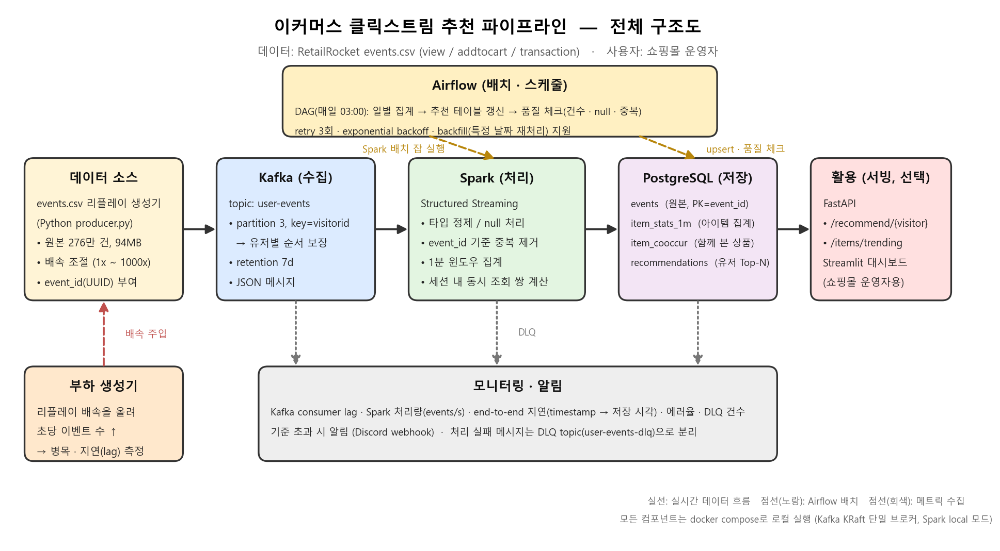
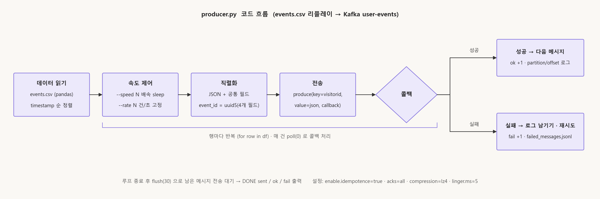

메타코드 데이터 엔지니어 7기 · 이유석

```
repo/
├─ docker-compose.yml   # Kafka (KRaft 단일 브로커)
├─ create_topics.py     # 토픽 생성 (user-events, user-events-dlq)
├─ producer.py          # events.csv 리플레이 -> Kafka  
├─ consumer.py          # 콘솔 consumer, 확인용      
├─ preprocess.py        # Spark 전처리 · 집계           
├─ dag.py               # Airflow DAG                  
├─ schema.sql           # PostgreSQL 스키마            
├─ data/events.csv      # Kaggle 에서 다운로드 (git 제외)
└─ docs/pipeline_architecture.png
```

---

## 1. 사용 데이터

**Retailrocket recommender system dataset** (Kaggle 공개, CC BY-NC-SA 4.0)
https://www.kaggle.com/datasets/retailrocket/ecommerce-dataset

실제 이커머스 사이트에서 2015-05-03부터 4.5개월 동안 수집한 유저 행동 로그. 이 중 `events.csv` 사용

### 스키마 (`events.csv`)

| 필드 | 타입 | 설명 | 예시 |
|---|---|---|---|
| `timestamp` | int64 | 이벤트 발생 시각 (Unix epoch, 밀리초) | `1433221332117` |
| `visitorid` | int64 | 유저 ID (해시) | `257597` |
| `event` | string | `view` / `addtocart` / `transaction` | `view` |
| `itemid` | int64 | 상품 ID (해시) | `355908` |
| `transactionid` | int64 (nullable) | 구매 이벤트일 때만 채워지는 주문 ID | `4000` |

```csv
timestamp,visitorid,event,itemid,transactionid
1433221332117,257597,view,355908,
1433224214164,992329,view,248676,
1433222276276,599528,transaction,356475,4000
```
## 2. 전체 파이프라인 구조도



| 단계                      | 흐르는 것                             | 주기 |
|-------------------------|-----------------------------------|---|
| 생성기 -> Kafka            | JSON 이벤트 1건씩, key = visitor_id    | 리플레이 배속에 따라 (최대 수천 건/초) |
| Kafka -> Spark          | `user-events` 토픽 micro-batch      | 1분 트리거 |
| Spark -> PostgreSQL     | 정제 이벤트 upsert(event_id), 1분 집계    | 1분 |
| Spark -> Parquet        | 원본 append                         | 1분 |
| Airflow -> Spark/PostgreSQL | Parquet -> 일 집계, 추천 테이블 갱신, 품질 체크 | 매일 03:00 |
| PostgreSQL -> API       | 유저별 추천 Top-N, 트렌딩 아이템 SQL 조회      | 요청 시 |

---
### 3. Topic 구성

| 항목 | 값 | 이유                                                                         |
|---|---|----------------------------------------------------------------------------|
| 토픽명 | `user-events` | view · addtocart · transaction 와 같이 이벤트 종류가 달라도 같은 유저 안에서 발생 순서대로 읽어야 하기떄문 |
| 파티션 수 | 3 | 유저가 30명이면 각 파티션에 10명씩 들어가서 병렬처리로 성능을 올린다            파티션은 0,1,2 가존재         |
| key | `visitor_id` | visitor id %3 으로 파티션에 넣는다                                                  |
| 리텐션 | 7일  | 집계를 실수해서 데이터를 다시 봐야하는 상황이 그렇게 많지는 않을거같아서 7일로 했다.                           |
| DLQ | `user-events-dlq` (파티션 1, 리텐션 30일) | 두번째 토픽으로 메세지가 꺠져서 읽기가 실패한 데이터들을 모아둔 토픽                                     |

```
$ kafka-topics.sh --describe --topic user-events
Topic: user-events  PartitionCount: 3  ReplicationFactor: 1  Configs: retention.ms=604800000
    Partition: 0  Leader: 1  Replicas: 1  Isr: 1
    Partition: 1  Leader: 1  Replicas: 1  Isr: 1
    Partition: 2  Leader: 1  Replicas: 1  Isr: 1
```

**리스너 구성** (`docker-compose.yml`): 내 PC의 Python은 `localhost:9092`, 같은 compose 네트워크의 Spark · Airflow 컨테이너는 `kafka:29092`로 접속하도록 리스너를 두 개 열어 뒀다.
   

## 4. Kafka 수집 


### 4-1. Producer (`producer.py`)

```
CSV 읽기 -> 시간순 정렬 ->  (속도 제어: sleep) ->  JSON 직렬화 ->  produce(key, value) ->  콜백
                                                                                           ├─ 성공: ok 카운트, 처음 3건은 partition/offset 로그
                                                                                           └─ 실패: fail 카운트, failed_messages.jsonl 에 기록
```


**Producer 설정**

| 설정 | 값 |
|---|---|---|
| `enable.idempotence` | `true` 
| `acks` | `all` 
| `compression.type` | `lz4` 
| `linger.ms` | `5`
   

### 4-3. message examples

key = `"1149227"` (visitorid)

```json
{
  "event_id": "bf7a5319-89f5-45d6-b21a-758d81e99189",
  "event_type": "view",  
  "event_time": "2015-05-03T03:00:27.031Z",
  "produced_at": "2026-10-26T02:33:54.794Z",
  "schema_version": 1,
  "source": "replay-generator",
  "payload": {
    "visitor_id": 1149227,
    "item_id": 29757,
    "transaction_id": null
  }
}


```


**producer 실행 로그** 

```
INFO loading data/events.csv
INFO rows to send: 20000
INFO sent=5000 ok=0 fail=0  63280 msg/s
INFO sent=10000 ok=0 fail=0  62865 msg/s
INFO sent=20000 ok=0 fail=0  64246 msg/s
INFO delivered  topic=user-events partition=1 offset=0 key=693516
INFO delivered  topic=user-events partition=1 offset=1 key=652699
INFO delivered  topic=user-events partition=1 offset=2 key=693516
INFO DONE sent=20000 ok=20000 fail=0 unflushed=0 elapsed=1.1s avg=17899 msg/s
```


**`--rate 200` 실행** 

```
INFO rows to send: 1000
INFO sent=500 ok=498 fail=0  200 msg/s
INFO sent=1000 ok=999 fail=0  200 msg/s
INFO DONE sent=1000 ok=1000 fail=0 unflushed=0 elapsed=5.0s avg=200 msg/s
```

**consumer 로 읽은 결과** 

```
[p2 off=0] key=1149227  view        item=29757   event_time=2015-05-03T03:00:27.031Z
[p2 off=1] key=1150418  view        item=374675  event_time=2015-05-03T03:00:38.570Z
[p2 off=2] key=1143053  view        item=463330  event_time=2015-05-03T03:00:48.174Z
[p2 off=3] key=1222029  view        item=75831   event_time=2015-05-03T03:00:51.805Z
[p2 off=4] key=990356   view        item=161722  event_time=2015-05-03T03:00:54.461Z
```


---
## 5. 전처리 · 저장 (4회차)

Kafka `user-events` → Spark Structured Streaming(`preprocess.py`) → Parquet(원본 보관) + PostgreSQL(조회용).
처리 흐름 · 입출력 예시 · 최종 스키마 · 저장 포맷 선택 이유는 `docs/4회차_전처리_저장.pdf` 참고.

### 5-1. 실행 방법

```bash
# 0) 준비 — Python 3.10 + Java 17/21 (pyspark 3.5.3 은 Python 3.13 에서 워커가 죽는다)
pip install -r requirements.txt

# 1) Kafka + PostgreSQL 기동 (postgres 는 첫 기동 때 schema.sql 을 자동 실행해서 테이블을 만든다)
docker compose up -d
python create_topics.py                       # user-events, user-events-dlq

# 2) 수집 (3회차)
python producer.py --limit 20000 --speed 0    # CSV 리플레이 → Kafka
python consumer.py --max 5                    # 들어갔는지 눈으로 확인

# 3) 전처리 · 저장 (4회차)
python preprocess.py                          # 지금까지 쌓인 메시지를 전부 처리하고 종료 (trigger availableNow)
python preprocess.py --continuous             # 1분마다 micro-batch 를 계속 돌림 (Ctrl+C 종료)
python preprocess.py --reset                  # 체크포인트 삭제 후 토픽 처음부터 재처리 (재실행 테스트용)

# 4) 결과 조회
docker exec postgres psql -U clickstream -d clickstream -c "select event_type, count(*) from events group by 1;"
docker exec postgres psql -U clickstream -d clickstream -c "select * from item_stats_1m order by view_cnt desc limit 5;"
docker exec kafka /opt/kafka/bin/kafka-console-consumer.sh --bootstrap-server localhost:9092 --topic user-events-dlq --from-beginning --timeout-ms 5000
```

최초 실행 때 Spark 가 Kafka 커넥터와 PostgreSQL JDBC 드라이버를 Maven 에서 내려받는다 (인터넷 필요, 1회).

### 5-2. 입력 · 출력 위치

| 구분 | 위치 | 형식 | 비고 |
|---|---|---|---|
| 입력 | Kafka `user-events` (`localhost:9092`) | JSON 메시지, key = visitor_id | 3회차 producer 가 쌓은 것 |
| 진행 위치 | `checkpoint/preprocess/` | Spark 체크포인트 (Kafka offset) | 지우면 처음부터 다시 읽음 |
| 출력 ① 원본 보관 | `data/parquet/events/dt=YYYY-MM-DD/*.parquet` | Parquet, 날짜 파티션, append | 재처리 입력 · 영구 보관 |
| 출력 ② 조회용 | PostgreSQL `localhost:5432` db `clickstream` (user/pw `clickstream`) | `events`, `item_stats_1m` 테이블 | `events_staging` 은 배치 적재용 임시 테이블 |
| 출력 ③ 실패 격리 | Kafka `user-events-dlq` | 원문 + `dlq_reason` + partition/offset | 파싱 · 검증 실패 메시지 |

**실제 실행 결과** (Kafka 에 쌓여 있던 23,000건)

```
INFO batch=0 kafka=23000 parsed_ok=23000 dlq=0 dedup=23000(-0) | pg inserted=23000 skipped_existing=0 stats_upsert=22194 | parquet=data/parquet/events | 7.5s
INFO DONE 쌓인 메시지 처리 완료
```

| 확인 | 결과 |
|---|---|
| `events` 건수 / 종류 | 23,000 (view 22,354 · addtocart 523 · transaction 123), 2015-05-03 03:00 ~ 05-04 15:34 UTC |
| `item_stats_1m` | 22,194행, 합계가 events 와 일치 (views 22,354 / carts 523 / tx 123) |
| Parquet | `dt=2015-05-03` 8파일, `dt=2015-05-04` 8파일, 23,000행 |
| 깨진 메시지 2건 주입 | `dlq=2` → `user-events-dlq` 에 `invalid_json`, `bad_event_type` 이유와 함께 격리, events 에는 안 들어감 |

**같은 입력을 다시 처리하면**

| 상황 | 결과 |
|---|---|
| 그냥 다시 실행 (체크포인트 유지) | 새 offset 이 없어서 아무것도 처리 안 함. 저장 결과 변화 없음 |
| `--reset` 으로 처음부터 재처리 | `pg inserted=0 skipped_existing=23000`. `events` 는 PK 로 23,000 그대로, `item_stats_1m` 은 재계산이라 내용 md5 가 전후 동일 |
| 단, Parquet | append 라 23,000 → 46,000행 (distinct event_id 는 23,000). 아래 남은 문제 |

### 5-3. 남은 문제

- **Parquet 재처리 중복.** 체크포인트를 지우고 다시 돌리면 같은 이벤트가 파일로 또 쌓인다. 읽는 쪽에서 `event_id` 로 중복 제거하거나, 배치별 폴더에 쓰고 주기적으로 compaction 하는 쪽으로 정리 필요. DLQ 도 같은 이유로 재처리 때 다시 쌓인다.
- **`acks=all` 이 단일 브로커에선 의미가 없다.** 복제 계수 1이라 브로커 1대가 죽으면 Kafka 에 있는 데이터는 사라진다. 로컬 실습 한계. Parquet 이 그래서 필요하다.
- **1분 집계 재계산 비용.** 배치가 건드린 윈도우만 `events` 에서 다시 세는 방식이라 정확하지만, 배속을 올려 한 배치에 수천 개 윈도우가 들어오면 그만큼 느려진다. 6회차 로드 테스트에서 측정.
- **아직 없는 테이블.** `item_cooccur`(함께 본 상품), `recommendations`(유저별 Top-N) 는 Airflow 일배치(5회차) 몫. 스트리밍에서 30분 세션 self-join 은 상태가 커져서 배치로 뺐다.
- **환경.** pyspark 3.5.3 은 Python 3.13 에서 워커가 죽어서 3.10 으로 실행. Windows 에서 Spark 종료 시 `snappy-java.jar 삭제 실패` 경고가 뜨는데 임시 파일 정리 문제라 결과에는 영향 없음.
